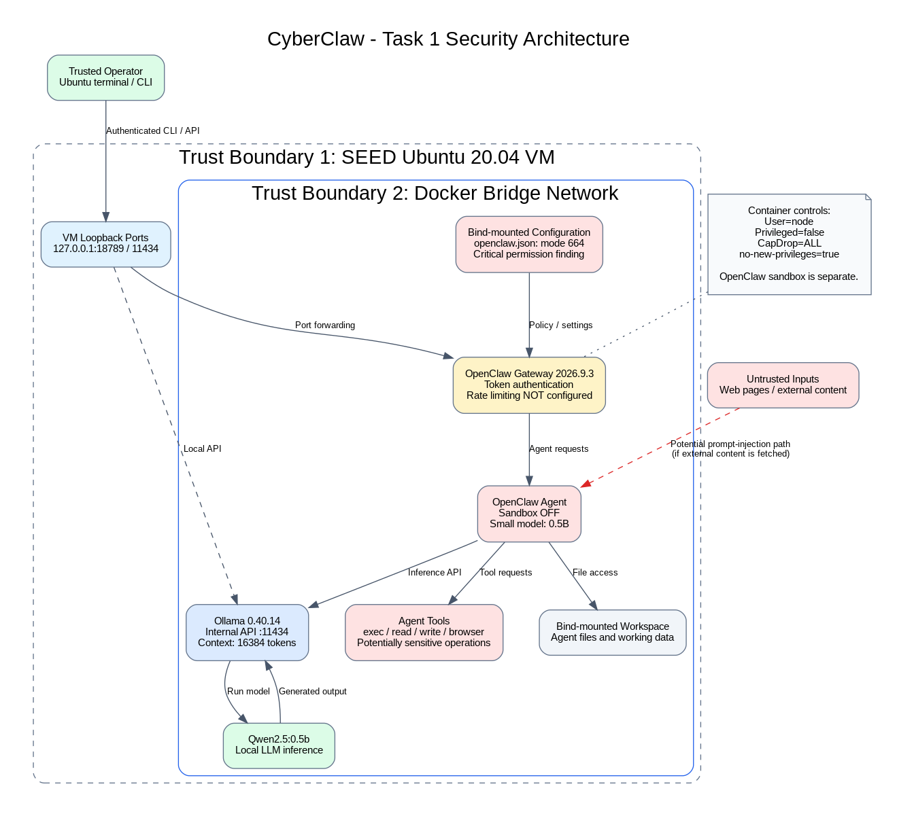

# CyberClaw: Security Analysis and Hardening of Agentic AI Frameworks

## Project Overview

CyberClaw is a computer security project investigating the OpenClaw autonomous AI agent framework.

The project focuses on understanding how AI agents interact with external tools, files, and services, identifying security weaknesses, and evaluating defensive techniques.

The project includes environment setup, architecture analysis, red-team security testing, and blue-team hardening.

## Task 1 — Environment Setup and Security Analysis

**Status:** Environment operational; baseline security analysis completed.

### Environment

| Component | Version |
|---|---|
| Operating system | SEED Ubuntu 20.04.1 LTS |
| Virtualization | VirtualBox on Intel Mac |
| Docker Engine | 20.10.21 |
| Docker Compose | v2.30.3 |
| OpenClaw | 2026.9.3 |
| Ollama | 0.40.14 |
| Language model | Qwen 2.5 0.5B |

The environment uses Docker Compose to deploy OpenClaw and Ollama as separate services.

OpenClaw communicates with Ollama through an internal Docker bridge network.

### Functional Verification

The environment successfully completed an end-to-end agent inference test.

**Prompt:** `Say hello from CyberClaw`

**Response:** `Hello! I'm CyberClaw, your personal assistant. Let's chat.`

The model used was `ollama/qwen2.5:0.5b`, with no fallback provider.

### Architecture



The architecture diagram identifies the main components, trust boundaries, tool interfaces, and security concerns.

See [Security Architecture Analysis](analysis/README.md) for details.

### Baseline Security Findings

The OpenClaw security audit reported:

| Severity | Finding |
|---|---|
| Critical | Small model with sandboxing disabled and web tools available |
| Critical | Configuration file writable by others |
| Warning | Gateway authentication rate limiting not configured |
| Information | Elevated tools and browser control enabled |

The Docker inspection confirmed that the OpenClaw container runs as a non-root user, without privileged mode, with Linux capabilities dropped and `no-new-privileges` enabled.

These observations provide the basis for analyzing least privilege, complete mediation, and fail-safe defaults.

### Repository Structure

```text
project-cyberclaw/
├── README.md
├── .gitignore
├── environment/
│   ├── README.md
│   ├── docker-compose.yml
│   └── config/
│       └── openclaw.json
└── analysis/
    ├── README.md
    ├── architecture-diagram.dot
    ├── architecture-diagram.png
    └── evidence/
        ├── security-audit-baseline.txt
        └── docker-security-baseline.txt
```

Runtime files, credentials, tokens, and local session data are excluded from version control.

## Running the Environment

From the repository root:

```bash
cd environment
docker compose up -d
```

For first-time setup, configuration, model installation, and troubleshooting, follow [Environment Setup](environment/README.md).

## Security Principles

The project examines three foundational computer security principles:

**Least privilege:** Restrict agent and tool permissions to the minimum necessary.

**Complete mediation:** Check authorization whenever a protected resource is accessed.

**Fail-safe defaults:** Deny access by default unless explicitly authorized.

The baseline analysis identifies where these principles are partially implemented or violated.

## Future Project Phases

### Task 2 — Red Teaming

Identify and evaluate security weaknesses using authorized tests within the isolated project environment.

### Task 3 — Blue Teaming

Implement defensive controls and evaluate whether they mitigate the identified weaknesses.

### Final Deliverables

Document experiments, security findings, mitigations, and evaluation results.

## AI Assistance Disclosure

ChatGPT assisted with setup instructions, and documentation. The student personally carried out the terminal steps and observed the Gateway, API and model responses on the MacBook along with other team.

Commands were executed in the SEED Ubuntu VM, and reported observations are based on terminal output. Generated documentation should be reviewed for accuracy before submission.
