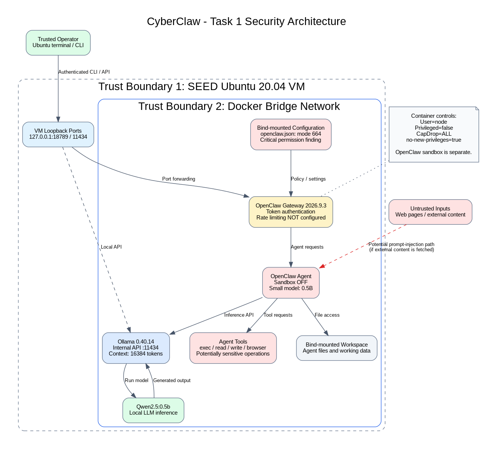

# CyberClaw — Security Architecture Analysis

## 1. Overview

CyberClaw is a security analysis project based on the OpenClaw autonomous AI agent framework. The purpose of this project is to examine the security implications of connecting a language model to tools, files, and external resources.

The environment runs inside a SEED Ubuntu 20.04 virtual machine hosted in VirtualBox on an Intel-based Mac. Docker Compose manages two containers:

- **OpenClaw Gateway:** `ghcr.io/openclaw/openclaw:2026.9.3`
- **Ollama:** `ollama/ollama:0.40.14`

The configured language model is `qwen2.5:0.5b`, running locally through Ollama.

## 2. System Architecture



The architecture consists of the following components:

**Host and virtual machine:** VirtualBox provides a separate Ubuntu environment for security testing.

**Docker containers:** OpenClaw and Ollama run in separate containers connected through a Docker bridge network.

**OpenClaw Gateway:** Receives agent requests, manages sessions, and coordinates interactions with the language model and available tools.

**Ollama:** Provides the local language-model inference API on port 11434.

**Language model:** Qwen 2.5 0.5B generates responses and supports tool calling.

**Agent tools:** OpenClaw exposes capabilities including file operations, command execution, and potentially web-related functionality.

**Persistent storage:** Bind-mounted directories store OpenClaw configuration and workspace files. A Docker volume stores Ollama data.

The Gateway and Ollama ports are published on the VM's loopback interface rather than all host network interfaces.

## 3. Trust Boundaries and Attack Surface

The environment contains several security boundaries.

**Boundary 1 — Host and virtual machine:** The Ubuntu VM separates the experimental environment from the macOS host. This does not guarantee complete isolation from the host.

**Boundary 2 — Docker containers:** OpenClaw and Ollama execute in separate containers. OpenClaw runs as the `node` user, without privileged mode, with all Linux capabilities dropped and `no-new-privileges` enabled.

**Boundary 3 — Gateway authentication:** The OpenClaw Gateway requires token authentication. However, the baseline audit found no authentication rate limiting.

**Boundary 4 — Agent and external content:** External web content, files, or tool responses may contain attacker-controlled instructions. Such content must not automatically be treated as trusted instructions.

**Boundary 5 — Agent and operating-system tools:** The language model may request actions through tools. Tool execution can affect files, processes, or external services depending on permissions and configuration.

The baseline security audit identified two critical findings, one warning, and one informational finding.

## 4. Security Principle: Least Privilege

**Definition:** A component should receive only the permissions required to perform its intended task.

**Current implementation:**

The Docker container uses several least-privilege controls:

- Non-root `node` user.
- Privileged mode disabled.
- Linux capabilities dropped.
- `no-new-privileges` enabled.

However, the OpenClaw security audit reported that the agent sandbox was disabled and that web-related tools were available to the small language model. Elevated tools and browser control were also reported as enabled.

**Security concern:**

An agent with unnecessary tool permissions has a larger attack surface. If malicious content influences the model, the agent may attempt actions beyond the user's intended request.

**Recommended improvements:**

- Restrict tool access to the minimum necessary.
- Disable unused web and browser tools.
- Enable agent sandboxing where supported.
- Limit filesystem and network access.
- Require appropriate authorization for sensitive operations.

**Assessment:** Least privilege is partially implemented at the Docker layer but insufficiently enforced at the application layer.

## 5. Security Principle: Complete Mediation

**Definition:** Every access to a protected resource should be checked against the applicable security policy.

**Current implementation:**

The Gateway uses token authentication. The security audit nevertheless reported that authentication rate limiting was not configured.

OpenClaw also provides tools that may interact with the filesystem and operating system.

**Security concern:**

Authentication without rate limiting permits repeated authentication attempts without an application-level throttling control.

Additionally, agent-requested tool operations should be checked against explicit permissions rather than being trusted merely because they originate from the language model.

**Recommended improvements:**

- Configure Gateway authentication rate limiting.
- Apply authorization checks to sensitive tool operations.
- Validate tool parameters and target resources.
- Record security-relevant actions for auditing.
- Require explicit approval for high-risk operations where appropriate.

**Assessment:** Gateway authentication provides an initial access-control boundary, but additional controls are needed.

## 6. Security Principle: Fail-Safe Defaults

**Definition:** Access should be denied unless explicitly permitted. When a security control fails or a configuration is missing, the system should default to the safer behavior.

**Current implementation:**

The baseline audit found that the OpenClaw configuration file had permission mode `664`, allowing modification by users other than the owner.

The audit also reported that the agent sandbox was disabled while potentially dangerous tools remained available.

**Security concern:**

A user with write access to the configuration file could potentially modify authentication or tool policies.

A permissive agent configuration also increases the consequences of unexpected or malicious model behavior.

**Recommended improvements:**

- Restrict configuration file permissions to `600`.
- Enable sandboxing for agent execution.
- Disable unnecessary tools by default.
- Explicitly allow only required capabilities.
- Validate security settings before deployment.

**Assessment:** The baseline configuration does not consistently follow fail-safe defaults.

## 7. Baseline Security Audit

The command used to inspect OpenClaw security was:

```bash
docker exec cyberclaw-gateway node openclaw.mjs security audit
```

The audit reported:

| Severity | Finding |
|---|---|
| Critical | Small model operating without sandboxing and with web-related tools available |
| Critical | Configuration file writable by others (`664`) |
| Warning | Gateway authentication rate limiting not configured |
| Information | Elevated tools and browser control enabled |

Supporting evidence is stored in:

- `evidence/security-audit-baseline.txt`
- `evidence/docker-security-baseline.txt`

These findings describe the baseline environment before additional hardening.

## 8. Functional Verification

The environment was tested using an OpenClaw agent request routed to the local Ollama model.

**Test prompt:**

`Say hello from CyberClaw`

**Observed response:**

`Hello! I'm CyberClaw, your personal assistant. Let's chat.`

The execution completed successfully using `ollama/qwen2.5:0.5b`, with no fallback model.

An initial request failed because Ollama's allocated context window was too small. Increasing `OLLAMA_CONTEXT_LENGTH` to `16384` resolved the issue.

This test confirms successful language-model inference through OpenClaw. It does not establish that tool execution, sandboxing, or other security controls have been fully tested.

## 9. Planned Security Improvements

The next phase will focus on:

1. Restricting tool permissions.
2. Enabling agent sandboxing where feasible.
3. Correcting configuration file permissions.
4. Adding Gateway authentication rate limiting.
5. Testing the effectiveness of these controls against selected attack scenarios.

Security testing will be performed only in the authorized project environment.

## 10. AI Assistance Disclosure

ChatGPT was used to assist with environment setup instructions, architecture diagram drafting, and documentation. 
The student personally carried out the terminal steps and observed the Gateway, API and model responses on the MacBook along with other team.
